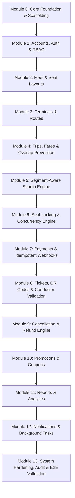

# Bus Ticket Management System — Comprehensive Backend Implementation Plan

## Executive Overview & Development Protocol

This document outlines the strict, module-by-module engineering roadmap for building the **Enterprise Bus Ticket Management System** in Django 5 & Django REST Framework (DRF) running on **PostgreSQL with GiST exclusion constraints** and Redis.

### Protocol: Strict Sequential Delivery & Testing
To guarantee 100% architectural integrity, data consistency, and production readiness:
1. **Module Isolation:** Development proceeds strictly one module at a time.
2. **Comprehensive Test Suites:** Each module includes automated tests (unit + integration) and automated test runner scripts.
3. **Interactive Verification:** For each module, we provide complete cURL requests, sample payload JSONs, and Swagger/OpenAPI instructions so you can directly test every single feature.
4. **Strict Gatekeeping:** Work on the next module will **only commence after your explicit review, testing, and approval** of the current module.

---

## Technical Foundations & Rigorous Architectural Rules

Based on strict technical review, the following core architecture rules are enforced across all modules:

### 1. PostgreSQL & Real Multi-Threaded Concurrency Testing
- **No SQLite Concurrency Fallacies:** Because `select_for_update()` is a no-op on SQLite and SQLite serializes operations, **PostgreSQL 16+ via Docker Compose is the mandatory database engine**.
- **Real Threaded Race Testing:** Race conditions and lock acquisition tests are written using `TransactionTestCase` and execute multiple real operating system threads (`threading.Thread`) against the live PostgreSQL database.

### 2. Database-Level Double-Booking Prevention via PostgreSQL ExclusionConstraint
- Application-level locks (`select_for_update`) provide primary flow control, but **database-level mathematical impossibility of double-booking** is enforced via PostgreSQL GiST index with the `btree_gist` extension.
- `BookingSeat` defines an `IntegerRangeField` (`segment_range`) representing the half-open stop index interval `[from_stop_order, to_stop_order)`.
- Database constraint:
  ```python
  ExclusionConstraint(
      name='exclude_overlapping_seats_on_trip',
      expressions=[
          ('trip', RangeOperators.EQUAL),
          ('seat', RangeOperators.EQUAL),
          ('segment_range', RangeOperators.OVERLAPS),
      ],
      condition=Q(status__in=['LOCKED', 'BOOKED']),
  )
  ```
- Result: Even under high-concurrency race conditions or unexpected application crashes, PostgreSQL will physically reject any overlapping seat-segment reservation with a database `IntegrityError`.

### 3. Unified Segment Representation Across All Models
- A `Terminal` is a physical geographic station.
- A `RouteStop` is an ordered node in a `Route`, with an integer `stop_order` (0, 1, 2, ..., N), distance, and offset minutes.
- Every segment in the system is consistently represented by:
  - `from_stop = ForeignKey(RouteStop, related_name='+')`
  - `to_stop = ForeignKey(RouteStop, related_name='+')`
  - `from_stop_order = PositiveSmallIntegerField()`
  - `to_stop_order = PositiveSmallIntegerField()`
  - `segment_range = IntegerRangeField()` (`[from_stop_order, to_stop_order)`)
- This exact representation is used uniformly in `SeatLock`, `BookingSeat`, `FareRule`, and `Booking`.

### 4. Lock Design: Query-Time Correctness vs Asynchronous Housekeeping
- Availability queries and booking validation **must never depend on background cleanup workers for correctness**.
- Every seat map, search, and booking query explicitly filters on:
  ```python
  SeatLock.objects.filter(trip=trip, locked_until__gt=timezone.now())
  ```
- Any lock whose `locked_until <= now` is treated as dead immediately in-flight by SQL query filters.
- The Celery Beat cleanup task functions solely as background garbage collection to prevent table bloat.

### 5. Explicit State Machines & Trip Seat Blocking
- `BookingSeat.status`: Directly holds status (`LOCKED`, `BOOKED`, `CANCELLED`, `COMPLETED`, `NO_SHOW`). This eliminates expensive multi-table joins on every availability check.
- `BookingStatus` Lifecycle:
  ```
  PENDING -> CONFIRMED -> COMPLETED
                       -> PARTIALLY_CANCELLED
                       -> CANCELLED
                       -> REFUNDED
                       -> NO_SHOW
          -> EXPIRED
  ```
- **Trip Seat Blocking:** `Seat.is_active` represents hardware status (e.g. broken seat permanently in maintenance). Single-trip operational blocks (VIP, Driver/Staff, temporary fault) are modeled via `TripSeatBlock(trip, seat, reason, blocked_by)`.
- **Ladies-Only:** `Seat.is_ladies_only` is treated strictly as an immutable seat attribute, not a dynamic availability status.

### 6. Identity & Guest / Walk-In Support
- `Booking.user` is nullable (`null=True, blank=True`).
- `Booking` directly stores `passenger_name`, `passenger_phone`, and `passenger_email` to support guest web checkout and counter agent cash bookings without requiring customer account creation.
- Counter bookings link `booked_by_agent = ForeignKey(User)`.

### 7. Monetary Precision, Prorated Discounts & Financial Accounting
- All monetary fields use `DecimalField(max_digits=12, decimal_places=2)`.
- Standard banking rounding rule: `ROUND_HALF_UP` via `common.money.round_currency()`.
- Server-side authoritative price calculation:
  $$\text{Gross Fare} = \sum \text{Seat Prices}$$
  $$\text{Taxable Fare} = \text{Gross Fare} - \text{Coupon Discount}$$
  $$\text{Tax Amount} = \text{round}(\text{Taxable Fare} \times \text{TAX\_RATE\_PCT}, 2)$$
  $$\text{Service Fee} = \text{SERVICE\_FEE\_FIXED}$$
  $$\text{Net Total Payable} = \text{Taxable Fare} + \text{Tax Amount} + \text{Service Fee}$$
- **Prorated Refund Calculation:**
  - When cancelling a seat from a discounted booking, the discount is prorated across seats:
    $$\text{Seat Effective Fare} = \text{Seat Base Price} - \left(\frac{\text{Seat Base Price}}{\text{Gross Fare}} \times \text{Total Discount}\right)$$
  - Tax is refunded proportionally to the refunded fare.
  - Fixed service fees are non-refundable.

---

## Architecture & Tech Stack

```
                          +-------------------------------------------------+
                          |               Client Applications               |
                          |  (Web Passenger, Counter Agent, Conductor App)  |
                          +------------------------+------------------------+
                                                   | HTTPS / JWT
                                                   v
                          +-------------------------------------------------+
                          |             Nginx / Reverse Proxy               |
                          +------------------------+------------------------+
                                                   |
                                                   v
+---------------------------------------------------------------------------------------------------+
|                                 Django 5 REST Framework Backend                                   |
|                                                                                                   |
|  +---------------------+   +---------------------+   +---------------------+   +---------------+  |
|  |     accounts        |   |        fleet        |   |       routes        |   |     trips     |  |
|  | User, Roles, Auth   |   | Buses, Seats, Staff |   | Terminals, Segments |   | Trips, Fares  |  |
|  +----------+----------+   +----------+----------+   +----------+----------+   +-------+-------+  |
|             |                         |                         |                      |          |
|  +----------v-------------------------v-------------------------v----------------------v-------+  |
|  |                                  search & availability                                      |  |
|  |             Segment-Aware Graph Availability (Filter: locked_until > now())                 |  |
|  +--------------------------------------------+------------------------------------------------+  |
|                                               |                                                   |
|  +--------------------------------------------v------------------------------------------------+  |
|  |                              bookings & concurrency engine                                  |  |
|  |      select_for_update() + PostgreSQL GiST ExclusionConstraint on (trip, seat, segment)    |  |
|  +----------+---------------------------------+----------------------------------------+-------+  |
|             |                                 |                                        |          |
|  +----------v----------+   +------------------v--+   +-------------------+   +---------v-------+  |
|  |      payments       |   |       tickets       |   |   cancellations   |   |   promotions    |  |
|  | Gateways, Webhooks  |   | QR, PDF, Manifest   |   | Prorated Refunds  |   | Coupons, Taxes  |  |
|  +---------------------+   +---------------------+   +-------------------+   +-----------------+  |
+-----------------------------------------------+---------------------------------------------------+
                                                |
                 +------------------------------+------------------------------+
                 v                                                             v
+--------------------------------------------------+         +----------------------------------+
|           PostgreSQL 16 + btree_gist             |         |         Redis 7 / Celery         |
|  ExclusionConstraint on                          |         |  Housekeeping Lock Expiry,       |
|  (trip, seat, [from_order, to_order))            |         |  Async Reminders & Receipts      |
+--------------------------------------------------+         +----------------------------------+
```

---

## Detailed Module Roadmap & Test Matrix



---

### Module 0: Project Setup & Core Foundation
**Goal:** Establish clean configuration, PostgreSQL/Docker connectivity with `btree_gist`, standard error handling, base models, monetary precision utilities, global enums, and interactive API documentation.

* **Components & Tasks:**
  - Create directory layout, virtual environment requirements (`requirements.txt`).
  - Docker Compose for PostgreSQL 16 (`postgres:16-alpine`) and Redis (`redis:7-alpine`).
  - Database initialization script: `docker/postgres/init-extensions.sql` enabling `CREATE EXTENSION IF NOT EXISTS btree_gist;`.
  - Django settings with environment variable management via `.env`.
  - Base models in `common/models.py`: `TimeStampedModel` (`created_at`, `updated_at`), `UUIDModel`, `IsActiveModel`, `BaseModel`.
  - Global status constants in `common/constants.py`: `BookingStatus`, `BookingSeatStatus`, `SeatType`, `BusType`, `TripStatus`, `PaymentStatus`.
  - Monetary precision engine in `common/money.py`: `round_currency()` with `ROUND_HALF_UP`, `calculate_booking_financials()`, `calculate_seat_refund()`.
  - Custom API exception handler (`common/exceptions.py`): consistent JSON error format `{ "success": false, "error": { "code": "...", "message": "...", "details": [...] } }`.
  - Standard response pagination (`StandardResultsSetPagination`).
  - OpenAPI 3 schema and Swagger UI (`/api/docs/`) & Redoc (`/api/redoc/`).
  - Health check endpoint (`GET /api/health/`).
* **Deliverables:** Working Django project running with documentation and health endpoints.
* **Testing & Verification Check:**
  - Test `GET /api/health/` -> returns HTTP 200 `{ "status": "healthy", "database": "healthy" }`.
  - Test Swagger UI and Redoc render.
  - Test monetary calculation and rounding unit tests.

---

### Module 1: Authentication, Accounts & RBAC
**Goal:** Provide secure user registration, multi-identifier login (email or phone), OTP verification, role-based access control, token blacklisting, and profile management.

* **Database Models (`apps/accounts/models.py`):**
  - `User`: Custom user extending `AbstractBaseUser`, `PermissionsMixin`.
    - Fields: `id` (UUID), `email` (unique, nullable), `phone` (unique, indexed), `role` (`PASSENGER`, `COUNTER_AGENT`, `OPERATOR`, `CONDUCTOR`, `SUPER_ADMIN`), `is_verified`, `is_active`, `failed_login_attempts`, `locked_until`, `created_at`.
  - `OTPVerification`: `id`, `user` or `identifier`, `otp_code` (hashed), `purpose` (`REGISTRATION`, `PASSWORD_RESET`, `LOGIN`), `expires_at`, `is_used`.
  - `PassengerProfile`: `user` (OneToOne), `full_name`, `gender` (`MALE`, `FEMALE`, `OTHER`), `dob`, `cnic_id_number`, `emergency_contact`.
  - `SavedPassenger`: `user` (ForeignKey), `full_name`, `gender`, `age`, `id_number`.
* **Business Logic & Security Rules:**
  - Phone and email normalization.
  - Failed login throttling: 5 failed attempts -> 15-minute account lock.
  - OTP expiration (e.g. valid for 5 minutes, single use).
  - Role-based permissions: `IsPassenger`, `IsCounterAgent`, `IsOperator`, `IsConductor`, `IsSuperAdmin`.
* **API Endpoints:**
  - `POST /api/auth/register/`
  - `POST /api/auth/verify-otp/`
  - `POST /api/auth/login/`
  - `POST /api/auth/refresh/`
  - `POST /api/auth/logout/`
  - `POST /api/auth/password-reset-request/` & `POST /api/auth/password-reset-confirm/`
  - `GET /api/accounts/profile/` & `PUT /api/accounts/profile/`
  - `GET /api/accounts/saved-passengers/`
* **Testing & Verification Checklist:**
  - Automated tests: test registration, duplicate email/phone rejection, OTP verification, lockout after 5 failed attempts, token blacklist on logout, role permission enforcement.

---

### Module 2: Fleet Management (Buses, Seat Layouts, Drivers)
**Goal:** Model buses, automated seat matrix generation (e.g. 2x2 luxury, 2x1 sleeper), ladies-only flags, and crew records.

* **Database Models (`apps/fleet/models.py`):**
  - `Bus`: `id`, `registration_number` (unique), `name_or_number`, `bus_type` (`STANDARD_AC`, `EXECUTIVE`, `SLEEPER`, `LUXURY`), `total_seats`, `amenities` (JSON: WiFi, charging ports, blankets, snacks), `status` (`ACTIVE`, `MAINTENANCE`, `RETIRED`).
  - `Seat`: `id`, `bus` (ForeignKey), `seat_number` (e.g. "1A", "1B", "S1"), `row`, `column`, `seat_type` (`WINDOW`, `AISLE`, `SLEEPER_LOWER`, `SLEEPER_UPPER`), `deck` (`LOWER`, `UPPER`), `is_ladies_only` (bool attribute), `is_active` (bool hardware flag).
  - `Driver`: `id`, `user` (OneToOne optional), `full_name`, `license_number` (unique), `phone`, `status` (`AVAILABLE`, `ON_TRIP`, `ON_LEAVE`).
  - `Conductor`: `id`, `user` (OneToOne optional), `full_name`, `employee_id` (unique), `phone`, `status`.
* **Business Logic & Services:**
  - Automatic seat generator service: Given rows, columns, deck count, and layout template (e.g., 2+2 or 2+1), automatically generate seats with correct numbering and seat types.
  - Unique constraint on `(bus, seat_number)` and `(bus, row, column, deck)`.
* **API Endpoints:**
  - `GET /api/fleet/buses/`
  - `POST /api/fleet/buses/` (Admin/Operator: create bus and generate seats)
  - `GET /api/fleet/buses/{id}/` (Detailed bus info with full seat layout)
  - `PATCH /api/fleet/buses/{id}/seats/{seat_id}/` (Configure ladies-only or seat type)
  - `CRUD /api/fleet/drivers/` & `CRUD /api/fleet/conductors/`
* **Testing & Verification Checklist:**
  - Automated tests: seat matrix generator matches total count; duplicate seat number rejected; role permission checks.

---

### Module 3: Terminals, Stops & Sequenced Routes
**Goal:** Model transit stations and sequenced intermediate route stops with distance and time progression.

* **Database Models (`apps/routes/models.py`):**
  - `Terminal`: `id`, `name`, `code` (e.g. "LHR-01"), `city`, `address`, `latitude`, `longitude`, `is_active`.
  - `Route`: `id`, `code` (e.g. "LHR-ISB-EXP"), `name`, `origin` (ForeignKey -> Terminal), `destination` (ForeignKey -> Terminal), `total_distance_km`, `estimated_duration_minutes`, `is_active`.
  - `RouteStop`: `id`, `route` (ForeignKey), `terminal` (ForeignKey), `stop_order` (0 for origin, 1 for stop 1, N for destination), `distance_from_origin_km`, `offset_minutes` (minutes from departure).
* **Business Logic & Validations:**
  - Origin terminal cannot equal destination terminal.
  - Strict sequential `stop_order` without duplicates on the same route.
  - Origin is stop 0; destination is the maximum stop order.
* **API Endpoints:**
  - `GET /api/routes/terminals/`
  - `POST /api/routes/terminals/`
  - `GET /api/routes/` & `GET /api/routes/{id}/`
  - `POST /api/routes/`
* **Testing & Verification Checklist:**
  - Automated tests: stop ordering validation, distance progression, circular route prevention.

---

### Module 4: Trips, Fares & Overlap Prevention
**Goal:** Schedule journeys on routes, manage segment fare rules, support per-trip seat blocking, and strictly prevent bus/crew double-scheduling.

* **Database Models (`apps/trips/models.py`):**
  - `Trip`: `id`, `trip_number` (unique), `route` (ForeignKey), `bus` (ForeignKey), `driver` (ForeignKey), `conductor` (ForeignKey), `departure_datetime`, `arrival_datetime`, `status` (`SCHEDULED`, `BOARDING`, `DEPARTED`, `COMPLETED`, `CANCELLED`), `base_fare` (Decimal).
  - `TripSeatBlock`: `id`, `trip` (ForeignKey), `seat` (ForeignKey), `reason` (CharField: e.g. "VIP", "Driver Rest", "Mechanical"), `blocked_by` (ForeignKey -> User), `created_at`.
  - `FareRule`: `id`, `route` (ForeignKey), `from_stop` (ForeignKey -> RouteStop), `to_stop` (ForeignKey -> RouteStop), `from_stop_order` (int), `to_stop_order` (int), `seat_type` (SeatType choices, optional), `fare_amount` (Decimal).
* **Business Logic & Integrity Constraints:**
  - **No Double-Booking for Fleet/Crew:** A bus or driver cannot be assigned to another trip whose `(departure_datetime, arrival_datetime)` overlaps.
  - **Trip Seat Blocking:** Allows blocking a seat for a *single trip* without changing the fleet-wide bus configuration.
  - **Fare Calculation Engine:** Given a trip and segment `[from_stop, to_stop]`, compute fare = `FareRule(from, to, seat_type)` or proportional base fare.
* **API Endpoints:**
  - `GET /api/trips/` & `POST /api/trips/`
  - `GET /api/trips/{id}/`
  - `POST /api/trips/{id}/block-seat/` & `DELETE /api/trips/{id}/unblock-seat/{seat_id}/`
  - `CRUD /api/trips/fare-rules/`
* **Testing & Verification Checklist:**
  - Automated tests: overlapping trip assignment for same bus/driver rejected with 400 Bad Request; segment fare lookup.

---

### Module 5: Search & Segment-Aware Availability Engine
**Goal:** High-performance search for trips between any two stops and real-time segment-aware seat availability.

* **Business Logic & Availability Engine (`apps/search/services.py`):**
  - **Segment Overlap Algorithm:**
    - Let route stops be indexed $0, 1, 2, \dots, N$.
    - A passenger searches travel from stop order $i$ to stop order $j$ ($i < j$).
    - A seat is occupied/locked for segment $[i, j)$ if there exists an active `BookingSeat` (status `LOCKED` or `BOOKED`) or valid `SeatLock` (with `locked_until > now()`) whose segment $[u, v)$ overlaps $[i, j)$, i.e. $\max(i, u) < \min(j, v)$.
    - Example: On route A(0) -> B(1) -> C(2) -> D(3), a seat booked for A->B ([0, 1)) is **completely free** for a passenger traveling B->D ([1, 3))!
  - **Correctness Without Cleanup Dependency:** Availability queries strictly check `locked_until > timezone.now()`.
  - **Dynamic Seat Status Evaluation:**
    - `AVAILABLE`: Free across all stops in the requested $[i, j)$ window.
    - `LOCKED`: Active temporary seat lock (`locked_until > now`).
    - `BOOKED`: Active confirmed booking seat.
    - `BLOCKED`: Blocked for this trip (`TripSeatBlock`) or inactive on bus (`Seat.is_active=False`).
    - Attribute flag: `is_ladies_only` indicates passenger gender restriction.
* **API Endpoints:**
  - `GET /api/trips/search/?origin_terminal={id}&destination_terminal={id}&date={YYYY-MM-DD}&passengers={count}&bus_type={type}`
  - `GET /api/trips/{id}/seats/?from_stop={id}&to_stop={id}`
* **Testing & Verification Checklist:**
  - Automated tests: verify segment math: book A->B; seat shows booked for A->B and A->C, but available for B->C!

---

### Module 6: Concurrency, Seat Locking & Booking Engine
**Goal:** Multi-threaded concurrency safety with PostgreSQL `ExclusionConstraint`, zero overselling, atomic PNR creation, and walk-in counter booking.

* **Database Models (`apps/bookings/models.py`):**
  - `SeatLock`: `id`, `trip` (ForeignKey), `seat` (ForeignKey), `from_stop` (ForeignKey -> RouteStop), `to_stop` (ForeignKey -> RouteStop), `from_stop_order` (int), `to_stop_order` (int), `segment_range` (IntegerRangeField: `[from_stop_order, to_stop_order)`), `user` (ForeignKey optional), `session_key` (for guest/unauthenticated), `locked_until` (DateTimeField).
  - `Booking`: `id` (UUID), `pnr` (unique, 8-character alphanumeric), `user` (ForeignKey, nullable for walk-ins/guests), `passenger_name` (CharField), `passenger_phone` (CharField), `passenger_email` (EmailField, optional), `booked_by_agent` (ForeignKey -> User, optional), `trip` (ForeignKey), `from_stop` (ForeignKey -> RouteStop), `to_stop` (ForeignKey -> RouteStop), `from_stop_order` (int), `to_stop_order` (int), `status` (BookingStatus choices), `total_gross_fare` (Decimal), `discount_amount` (Decimal), `tax_amount` (Decimal), `service_fee` (Decimal), `net_amount` (Decimal), `created_at`, `expires_at`.
  - `BookingSeat`:
    - `id` (UUID), `booking` (ForeignKey), `trip` (ForeignKey), `seat` (ForeignKey), `passenger_name`, `age`, `gender`, `id_number`, `price` (Decimal), `from_stop` (ForeignKey -> RouteStop), `to_stop` (ForeignKey -> RouteStop), `from_stop_order` (int), `to_stop_order` (int), `segment_range` (IntegerRangeField: `[from_stop_order, to_stop_order)`), `status` (BookingSeatStatus choices: `LOCKED`, `BOOKED`, `CANCELLED`, `COMPLETED`, `NO_SHOW`).
    - **PostgreSQL GiST ExclusionConstraint:**
      ```python
      ExclusionConstraint(
          name='exclude_overlapping_seats_on_trip',
          expressions=[
              ('trip', RangeOperators.EQUAL),
              ('seat', RangeOperators.EQUAL),
              ('segment_range', RangeOperators.OVERLAPS),
          ],
          condition=Q(status__in=['LOCKED', 'BOOKED']),
      )
      ```
* **Business Logic & Concurrency Control:**
  - `lock_seats()` and `confirm_booking()` executed within `transaction.atomic()` with `select_for_update()`.
  - Database ExclusionConstraint physically prevents double-booking even if application locking is bypassed.
  - Expiry checks ignore locks with `locked_until <= now`.
  - Gender rules: Male passenger cannot book `is_ladies_only` seats.
  - Max seats constraint (e.g. 6 seats per booking).
* **API Endpoints:**
  - `POST /api/bookings/lock-seats/`
  - `POST /api/bookings/` (Confirm booking from locked seats)
  - `GET /api/bookings/` & `GET /api/bookings/{pnr}/`
  - `POST /api/bookings/counter-agent/` (Immediate confirmation for counter agent with cash)
* **Testing & Verification Checklist:**
  - **Threaded Race Test:** Multi-threaded test with `TransactionTestCase` launching 10 concurrent threads attempting to book/lock the exact same seat on PostgreSQL. Exactly 1 succeeds; 9 receive 409 Conflict / Integrity rejection.

---

### Module 7: Payments, Webhooks & Financial Reconciliation
**Goal:** Pluggable payment gateway architecture, idempotent webhooks, instant seat release on failure, and financial receipts.

* **Database Models (`apps/payments/models.py`):**
  - `Payment`: `id` (UUID), `booking` (ForeignKey), `amount` (Decimal), `currency` (CharField: e.g. "PKR"), `method` (PaymentMethod choices), `status` (PaymentStatus choices), `gateway_reference`, `idempotency_key` (unique), `gateway_response_raw` (JSON), `paid_at`, `created_at`.
  - `PaymentReceipt`: `id`, `payment` (OneToOne), `receipt_number`, `issued_at`.
* **Business Logic & Security Rules:**
  - Pluggable gateway interface (`BasePaymentGateway`) with `MockPaymentGateway` and production gateways.
  - Webhook idempotency: repeated webhook calls with identical payload/signature must not duplicate credit or state changes.
  - Payment success -> atomic transition of `Booking` from `PENDING` -> `CONFIRMED` and `BookingSeat.status` -> `BOOKED`, triggers ticket generation.
  - Payment failure or timeout -> release seat locks and mark booking `EXPIRED` or `FAILED`.
* **API Endpoints:**
  - `POST /api/payments/initiate/`
  - `POST /api/payments/webhook/{gateway_name}/`
  - `GET /api/payments/{id}/` & `GET /api/payments/receipt/{receipt_number}/`
* **Testing & Verification Checklist:**
  - Automated tests: mock gateway success transitions booking to `CONFIRMED`; replay webhook test (idempotency); failed payment releases seats.

---

### Module 8: Tickets, QR Codes & Conductor Validation
**Goal:** E-tickets with encrypted/tamper-proof QR codes, downloadable PDF tickets, passenger manifest, and conductor scan-to-board API.

* **Database Models (`apps/tickets/models.py`):**
  - `Ticket`: `id` (UUID), `booking_seat` (OneToOne), `ticket_number` (unique), `qr_token` (signed JWT/HMAC cryptographic string), `status` (`ISSUED`, `BOARDED`, `CANCELLED`, `EXPIRED`), `boarded_at`, `conductor` (ForeignKey optional).
* **Business Logic & Features:**
  - Cryptographically signed QR payload: includes `ticket_id`, `pnr`, `trip_id`, `seat_number`, and HMAC signature.
  - PDF E-ticket generator using `reportlab`: branded ticket with passenger details, trip stops, departure time, terms, and QR code image.
  - Conductor validation endpoint:
    - Scans QR -> decrypts/verifies HMAC signature.
    - Rejects ticket if already scanned (`BOARDED`), invalid, or belongs to a different trip.
    - Transitions status to `BOARDED` with timestamp and conductor ID.
  - Passenger Manifest: conductor/driver view of all passengers, boarding stops, seat numbers, and boarding status.
* **API Endpoints:**
  - `GET /api/tickets/{ticket_number}/`
  - `GET /api/tickets/pnr/{pnr}/pdf/`
  - `POST /api/tickets/validate/` (Conductor QR validation endpoint)
  - `GET /api/trips/{id}/manifest/` (Conductor passenger manifest)
* **Testing & Verification Checklist:**
  - Automated tests: QR verification succeeds on first scan; second scan returns HTTP 400 "Ticket already used"; PDF generation produces valid PDF bytes.

---

### Module 9: Cancellation & Refund Engine
**Goal:** Multi-tiered cancellation fee engine, prorated coupon refunds, partial seat cancellations, trip cancellation bulk refunds, and seat release.

* **Database Models (`apps/cancellations/models.py`):**
  - `CancellationPolicy`: `id`, `name`, `hours_before_departure`, `refund_percentage` (Decimal), `cancellation_fee_fixed` (Decimal), `is_active`.
  - `Refund`: `id` (UUID), `booking` (ForeignKey), `payment` (ForeignKey), `refund_amount` (Decimal), `cancellation_fee` (Decimal), `status` (`REQUESTED`, `APPROVED`, `PROCESSED`, `FAILED`), `reason`, `processed_at`, `created_at`.
* **Business Logic:**
  - Tiered Policy Evaluation:
    - $T > 24\text{ hours}$: 90% refund (10% fee)
    - $6 \le T \le 24\text{ hours}$: 50% refund (50% fee)
    - $T < 6\text{ hours}$: 0% refund (non-refundable)
  - Prorated Coupon & Tax Accounting:
    - Discounts are prorated across seats: $\text{seat\_effective\_fare} = \text{seat\_price} - (\text{seat\_price} / \text{gross} \times \text{discount})$.
    - Proportional tax refunded with fare; fixed service fee is non-refundable.
  - **Partial Cancellation:** Cancelling individual seats updates `BookingSeat.status = CANCELLED`, which **immediately frees the PostgreSQL GiST exclusion constraint** and restores availability without complex table joins. Booking transitions to `PARTIALLY_CANCELLED` (or `CANCELLED` if all seats cancelled).
  - Operator trip cancellation: 100% full refund created for all bookings.
* **API Endpoints:**
  - `POST /api/bookings/{pnr}/cancel/`
  - `POST /api/bookings/{pnr}/cancel-seats/`
  - `GET /api/cancellations/refunds/`
  - `POST /api/admin/trips/{id}/cancel/`
* **Testing & Verification Checklist:**
  - Automated tests: test policy at 30h, 12h, and 3h before departure; partial cancellation frees GiST exclusion; verify prorated refund amounts.

---

### Module 10: Promotions, Coupons & Dynamic Pricing
**Goal:** Coupon discount engine with strict server-side calculation, usage limits, and dynamic pricing rules.

* **Database Models (`apps/promotions/models.py`):**
  - `Coupon`: `id`, `code` (unique, uppercase), `discount_type` (`PERCENTAGE`, `FLAT`), `discount_value` (Decimal), `min_booking_amount` (Decimal), `max_discount_amount` (Decimal), `valid_from`, `valid_to`, `max_total_uses`, `max_uses_per_user`, `current_usage_count`, `is_active`.
  - `CouponUsage`: `id`, `coupon` (ForeignKey), `user` (ForeignKey), `booking` (ForeignKey), `discount_applied` (Decimal), `used_at`.
* **Business Logic & Anti-Tampering:**
  - Server-side price authority: backend evaluates base fare + seat surcharge - coupon discount.
  - Validation: check expiry date, minimum order value, total usage quota, and per-user quota.
* **API Endpoints:**
  - `POST /api/promotions/apply-coupon/`
  - `CRUD /api/admin/promotions/coupons/`
* **Testing & Verification Checklist:**
  - Automated tests: percentage discount capped at `max_discount`; expired coupon rejected; per-user limit strictly enforced.

---

### Module 11: Reports & Analytics Engine
**Goal:** Admin & Operator business intelligence: revenue, load factor (occupancy rate), route performance, and agent commissions with CSV/Excel export.

* **Analytics Calculations & Services (`apps/reports/services.py`):**
  - Revenue metrics: daily, weekly, monthly gross and net revenues.
  - Occupancy Rate / Load Factor: total passenger-kilometers divided by total seat-kilometers across routes.
  - Top routes and peak travel hours.
  - Counter Agent sales volume and commission reconciliation.
  - CSV / Excel exporter utility.
* **API Endpoints:**
  - `GET /api/admin/reports/revenue/?start_date=&end_date=&group_by=day`
  - `GET /api/admin/reports/occupancy/?trip_id=&route_id=`
  - `GET /api/admin/reports/agent-sales/`
  - `GET /api/admin/reports/export/?type=revenue&format=csv`
* **Testing & Verification Checklist:**
  - Automated tests: test aggregation math for revenue, occupancy formula, and CSV stream generation.

---

### Module 12: Notifications & Background Tasks (Celery / Redis)
**Goal:** Asynchronous notifications (Email, SMS) and automated background maintenance (seat lock expiration, departure reminders).

* **Database Models (`apps/notifications/models.py`):**
  - `NotificationLog`: `id`, `user` (ForeignKey), `recipient`, `channel` (`EMAIL`, `SMS`), `subject`, `template_name`, `status` (`PENDING`, `SENT`, `FAILED`), `error_message`, `sent_at`.
* **Celery Tasks (`apps/notifications/tasks.py`):**
  - `send_booking_confirmation_notification(booking_id)`
  - `send_payment_receipt_notification(payment_id)`
  - `send_cancellation_notification(booking_id)`
  - `send_departure_reminder_task()` (Scheduled reminder T-2 hours before trip)
  - `cleanup_expired_seat_locks()` (Housekeeping beat task to delete expired locks)
* **API & Admin Endpoints:**
  - `GET /api/admin/notifications/logs/`
* **Testing & Verification Checklist:**
  - Automated tests: test task dispatch with `CELERY_TASK_ALWAYS_EAGER = True`; test housekeeping cleanup task.

---

### Module 13: System Hardening, Audit Logging & End-to-End Validation
**Goal:** Production audit logging, security throttling, and complete end-to-end integration test validating the entire passenger journey.

* **Components & Hardening:**
  - `AuditLog` model & middleware: records user, action (`CREATE`, `UPDATE`, `CANCEL`), resource, IP address, timestamp, diff payload.
  - DRF Throttling: configure `AnonRateThrottle` (e.g. 60/min) and `UserRateThrottle` (e.g. 300/min).
  - End-to-End Master Test (`tests/test_full_journey.py`):
    1. Register passenger & verify OTP.
    2. Search trip for A -> C.
    3. Select and lock seats.
    4. Simulate payment success.
    5. Generate PDF ticket with QR code.
    6. Conductor scans and boards passenger.
    7. Partial cancellation of 1 seat with policy refund verification.
* **Testing & Verification Checklist:**
  - Run full test suite: `pytest` passes with 100% green across all modules.

---

## Interactive Step-by-Step Execution Plan

| Step # | Module | Scope | Status | Verification Check |
|---|---|---|---|---|
| **Step 0** | **Project Setup & Base Scaffolding** | Django 5, settings, exceptions, base models, money precision, Swagger docs, health endpoint | **COMPLETED** | Health check HTTP 200, Swagger UI renders, financial math tests pass |
| **Step 1** | **Accounts, Auth & RBAC** | Custom User, OTP, JWT, Lockout, Roles & Profiles | **COMPLETED** | Register, Login, OTP, JWT token refresh & blacklist tests |
| **Step 2** | **Fleet & Seat Layouts** | Bus CRUD, Seat matrix generator, Ladies-only, Drivers | **COMPLETED (Awaiting User Test)** | Generate 40-seat layout, inspect seat arrangement |
| **Step 3** | **Terminals & Routes** | Stations, sequenced intermediate stops, distance | Pending | Create sequenced route stops, test order validation |
| **Step 4** | **Trips & Fares** | Schedules, Bus/Driver overlap prevention, Segment fares, Trip seat block | Pending | Overlapping trip rejected, fare lookup verified |
| **Step 5** | **Search Engine** | Segment-aware availability algorithm, Seat status map, Query-time lock filtering | Pending | Query trips between stops, verify segment overlap math |
| **Step 6** | **Seat Locking & Booking** | Concurrency safe lock, GiST ExclusionConstraint, Atomic PNR, Counter booking | Pending | Multi-threaded race test passes on PostgreSQL |
| **Step 7** | **Payments & Webhooks** | Gateways, Idempotent webhooks, Auto-confirmation | Pending | Payment webhook confirmation, replay test |
| **Step 8** | **Tickets & QR Validation** | Signed QR codes, PDF tickets, Conductor scan API | Pending | Conductor validation marks used, rejects duplicate scan |
| **Step 9** | **Cancellations & Refunds** | Tiered policy engine, Partial cancel, Prorated discount/tax refund | Pending | Test 24h/6h refund tiers, GiST exclusion freed |
| **Step 10**| **Promotions & Coupons** | Server-side discount engine, Quotas, Usage rules | Pending | Apply coupon, check min amount and discount cap |
| **Step 11**| **Reports & Analytics** | Revenue, Occupancy, Agent sales, CSV export | Pending | Query report endpoints, download valid CSV |
| **Step 12**| **Notifications & Celery**| Email/SMS async tasks, Housekeeping lock cleanup beat | Pending | Dispatch test notifications, verify lock cleanup |
| **Step 13**| **Audit & Full E2E Test** | Audit logs, Rate limiting, Master journey test | Pending | Run complete E2E test suite |

---

## How Testing Will Work For Each Module

For each module, I will:
1. Implement the models, services, serializers, views, and URL routing.
2. Provide automated tests (`pytest` test file) covering all edge cases.
3. Provide a testing guide with:
   - Automated test execution command (e.g. `python manage.py test apps.accounts`).
   - Ready-to-copy cURL requests or interactive Swagger test steps.
   - Expected input payloads and expected response codes / JSON outputs.
4. **Pause and await your explicit confirmation** before moving to the next module.
